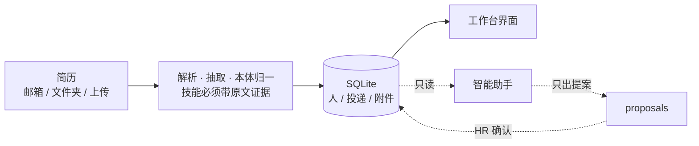

<div align="center">

# HRAgent 工作台

**会读简历，也会劝自己别乱动**

一个人一份档案 · 一档多投 · 每次改动留痕 · 数据不出内网


</div>

> **系统只给建议，HR 确认才生效。**
> 这不是文案，是结构约束：模型**拿不到**任何直接写库的路径。

本机运行的招聘工作台。一个 `exe` 起 FastAPI + SQLite 单文件库，数据全在本机、不上传、不调公网 API。
覆盖一条完整链路：**简历进来 → 判档 → 归岗 → 推进阶段 → 发面试邮件 → 归档**。



---

## 核心特性

| | 能力 | 一句话 |
|---|---|---|
| 🗂 | **三级数据模型** | 人 / 投递 / 附件分离，一个人可投多岗、多次、多版简历，互不覆盖 |
| 🛡 | **三层零重复** | `message_id` → `SHA256(附件)` → `identity_key`；先判重再落盘，原件区没有野文件 |
| 🧾 | **不丢件** | 解析失败照样建档并标「待人工判读」，每封邮件写收信台账 |
| 🔍 | **打分不是黑箱** | 每条档位带命中证据与缺失项；改 JD 后可「按新尺子重演」，先看差异再落库 |
| 🔐 | **联系方式加密** | AES-256-GCM；密文、盲索引、身份键一律不下发前端 |
| ♻️ | **删除是两段式的** | 归档 → 满 30 天才可彻底删除，未满天数点删除会被 409 拒绝并告知剩余天数 |
| 👥 | **账号与权限** | `hr` / `admin` / `viewer` 三角色 + 13 个权限点，登录默认开启 |
| 🚫 | **合规写进代码** | 性别只取简历明写标签、永不参与评分；民族/婚育/健康等字段在进模型**之前**被替换 |

## 三条反常识的设计

1. **反幻觉落到字节级**——每条技能必须定位到简历原文片段，抽不到证据就 `verified=0`、不计入岗位命中。模型说"他会 Java"，系统先问"原文哪一行"。
2. **说"我判不了"是合格答案**——候选人与所有在招岗位零交集时，如实报"尚无对应岗位"，不套一把不对的尺子。
3. **某些事永远不交给对话**——改模型配置、改来源目录这类有副作用又要审计凭证的操作，助手会说明它不接，把你引到对应页面自己点。

---

## 快速开始

### 桌面版（HR 用这个）

双击 `HRAgent工作台.exe` → 后台起服务（默认 `127.0.0.1:8756`，被占自动顺延）→ 托盘图标常驻 → 浏览器自动打开。

首次登录 `admin` / `change-me`，**登录后请立刻在「账号管理」里改掉**。

### 命令行 / 开发

```bash
pip install -r requirements.txt

python cli.py init                 # 建库、写岗位尺子、建管理员
python cli.py serve --port 8091    # http://127.0.0.1:8091
python cli.py doctor               # 环境体检：模型/向量/解析/邮箱/本体/密钥/权限
python cli.py selftest             # 端到端自检，近 400 条真实调用断言
```

其余命令：`fixtures`（造测试邮件）、`ingest --folder`（导入目录）、`mail`（收邮箱）、
`index`（建向量索引）、`search`、`report`、`audit`、`purge`、`majors`、`domains`、`import-domain`。

### 第一次使用建议顺序

`init` → `serve` →「岗位管理」建岗位（只写岗位名 + JD）→「邮箱配置」填 IMAP 并点测试连接 →
点「收取简历」→ 在「人才库」看结果。

> `TP_DB_PATH=/tmp/demo.db python cli.py serve` 可指向另一个库，演练时不碰真实人才库。

---

## 数据与配置在哪

| | 便携版 | 安装版 |
|---|---|---|
| 数据 | `<程序目录>\data\` | `%LOCALAPPDATA%\HRAgentData\data\` |
| 配置 | `<程序目录>\config\` | `%LOCALAPPDATA%\HRAgentData\config\` |

```
data/workbench.db     全部档案 / 投递 / 审计
data/master.key       加密主密钥（电话邮箱靠它解密，备份必须一起带走）
data/archive/         简历原件（按年月分目录，只增不改）
config/jd.json        岗位尺子      config/tiers.json       A/B/C/D 阈值
config/ontology.json  技能本体      config/majors.json      学科目录（13 门类 / 93 一级学科）
config/universities.json  985·211   config/model.json       模型服务（OpenAI 兼容）
config/mailbox.json   收发信配置     config/imap.secret      IMAP 口令（0600，不入版本库）
```

接内网大模型只改 `base_url` + `model`，不动代码；也支持 `LLM_BASE_URL` / `LLM_MODEL` / `LLM_API_KEY` 覆盖。

---

## 分级口径（`config/tiers.json`，可改）

| 档 | 含义 | 口径 |
|---|---|---|
| **A 优先面试** | 必需技能全中 + 学历年限达标 | score ≥ 0.85 |
| **B 建议面试** | 基本匹配，缺 1 项可培养 | score ≥ 0.65 |
| **C 储备** | 条件偏弱但有潜力 | score ≥ 0.45 |
| **D 暂不匹配** | 建议转其他岗位，**简历保留** | 其余 |

评分构成：学历 0.25 / 年限 0.25 / 必需技能 0.35 / 加分项 0.15。
学历或年限硬性不达标直接进 D；解析失败另标「待人工判读」，降 D 但不丢弃。
**专业不对口只提示、不参与淘汰。**

---

## 六条硬约束（代码层面的不变式）

| # | 约束 | 怎么保证 |
|---|---|---|
| 1 | **不丢件** | 先落盘再解析；解析失败照样建档并标记；每封邮件写台账 |
| 2 | **零重复** | 三层去重，先判重再落盘 |
| 3 | **反幻觉** | 技能必须有原文证据，否则不计命中 |
| 4 | **只建议不决定** | 模型无直接写库路径，写类工具只产出提案，经 HR 确认由 `actions.apply_proposal` 执行 |
| 5 | **合规屏蔽** | 敏感字段在进入任何模型之前被替换；性别只取明写标签、永不参与评分 |
| 6 | **最小权限 + 全程留痕** | 三角色 13 权限点；改档 / 改阶段 / 确认提案 / 账号变更全部落审计 |

**没有硬删除入口**：岗位只能停用；来源文件只移进 `data/removed/`（可原样恢复）；
**不自动发拒信、不对外发送任何消息**——相关工具在工具层被禁用。

---

## 目录结构

```
cli.py                命令行入口（init / mail / ingest / serve / selftest / doctor …）
webapp_launcher.py    桌面版启动器：单实例、端口顺延、托盘、自动开浏览器
build_release.py      打包脚本（PyInstaller，含安装器与热更新包）
app/
  db.py               17 张表、迁移、审计、统计、提案、岗位
  ingest.py           入库编排：去重 → 归档 → 解析兜底 → 归岗 → 判档
  regrade.py          改 JD 后按新尺子重算已有投递（默认预演）
  search.py           技能召回 + 语义召回（含哈希向量兜底）
  crypto.py           AES-256-GCM、盲索引、口令散列、脱敏
  auth.py             三角色 13 权限点
  actions.py          提案执行 —— **唯一真正写库的路径**
  server.py           FastAPI 路由
  ui_v2.py            单页工作台（原生 JS，无 CDN、无构建）
  avatar.py           证件照抽取      export.py   CSV 导出
  pipeline/           san 合规屏蔽 · parse 解析 · extract 抽取 · normalize 本体归一
                      majors 学科 · domains 领域包 · tier 分级 · analyze 模型增强
  agent/              llm 模型通道 · tools 工具集 · loop 调用循环与降级 · proactive 主动提示
config/               岗位尺子 / 本体 / 学科 / 院校 / 模型 / 邮箱
tests/                selftest（端到端断言）· ui_probe（界面截图验收）· make_fixtures
                      + 安装器迁移、启动链路、性能等专项回归
tools/                打包、升级器、界面 JS 校验、验收脚本
docs/                 设计方案、打包与热更新、升级指南、使用指南
```

---

## 文档

| 文档 | 给谁看 |
|---|---|
| [使用指南](docs/使用指南.md) | HR：装、导入、找人、改档案、写邮件、常见问题 |
| [功能清单](功能清单.md) | HR / 业务：功能边界、红线、界面说明 |
| [规划设计方案](docs/人才库智能体-规划设计方案.md) | 开发：整体设计取舍 |
| [打包与热更新方案](docs/打包与热更新方案.md) | 开发：发布链路 |
| [升级指南 2.0.0 → v2.2.5](docs/升级指南-2.0.0到v2.2.5.md) | 运维：老库升级步骤 |
| [完整版设计说明](docs/README-完整版.md) | 开发：数据模型、智能体治理、实测数据、逐项论证 |

---

## 已知边界

- **学科"语义兜底"仍是字面级**：向量服务降级为 `local-hash-v1`，目录没写、字面也不像的专业会如实落「无法判定」——保守但召回偏窄；
- **领域包无版本依赖与冲突检查**：别名冲撞按导入顺序决定，报告里会写明但不阻断；
- **建议岗位只看技能交集，不看专业需求**：专业对口但技能不在本体里的候选人会保持「待指定」；
- **图片简历不自动 OCR**：标「待人工判读」并留档；
- **真实 IMAP 需院内凭据**：代码就绪（只读 `BODY.PEEK[]`，不改已读）；
- **无"回收目录重新入库"入口**：来源文件只能移走 / 恢复。

## 合规

简历属个人敏感信息：本地部署、不出内网、按 30 天保留期留存、不调公网 API。
系统只建议不决定，不淘汰简历、不自动对外发送。
**性别**按《就业促进法》第二十七条处理：只取简历明写标签、不推断、筛选开关出厂关闭、**任何情况下不参与评分与分级**。
导出的 CSV 只含「个人简介 + 对应岗位」，不含档位、命中技能、推荐理由等内部评分口径。

---

<sub>自检：`python cli.py selftest` 覆盖解析、判定、证据核验、权限、提案流、检索、界面文案。</sub>
